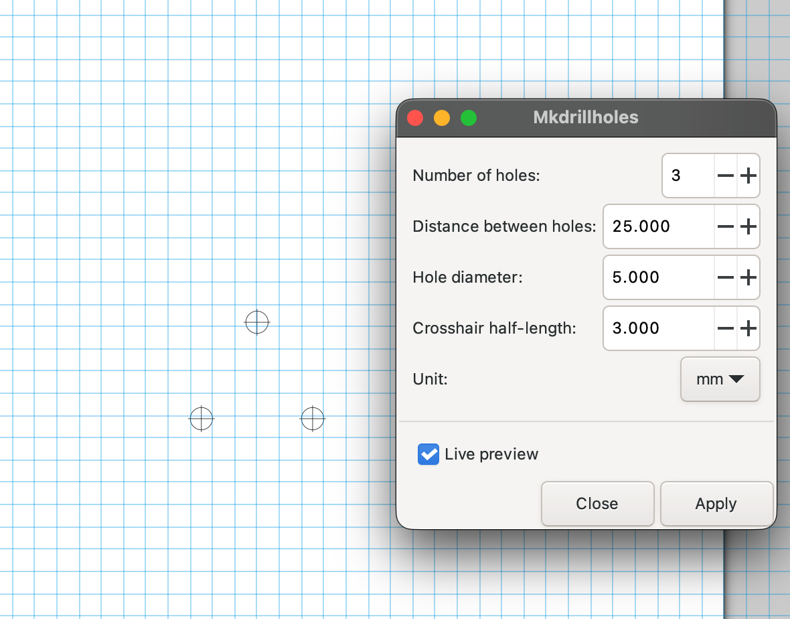

# Mkdrillholes

Inkscape extension for quick generation of
circular placed drillhole templates.



## Usage

Navigate to: menu bar -> Extensions -> Templating -> Mkdrillholes...

## Resources

Some tutorials on creating and editing Inkscape extensions:

- [Inkscape Extension Development Tutorial](https://inkscapetutorial.org/pages/extension.html)
- [inkex documentation - Writing Extensions: In-Depth](https://inkscape.gitlab.io/extensions/documentation/authors/index.html)

## Installation

### OSX

```shell
cp src/* "$HOME/Library/Application Support/org.inkscape.Inkscape/config/inkscape/extensions/"
```
